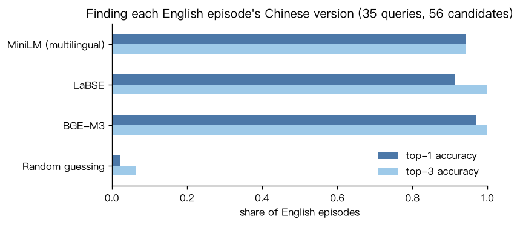
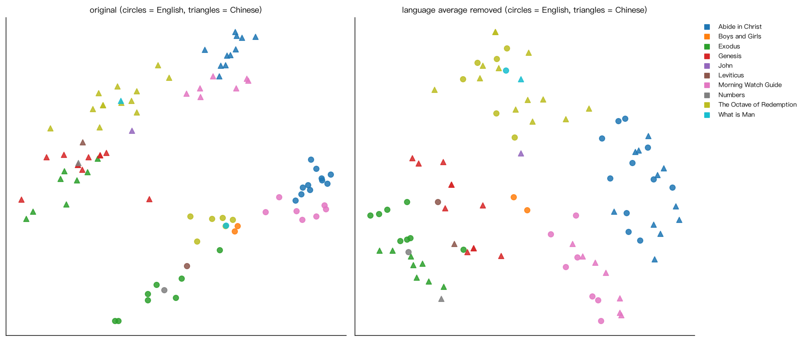
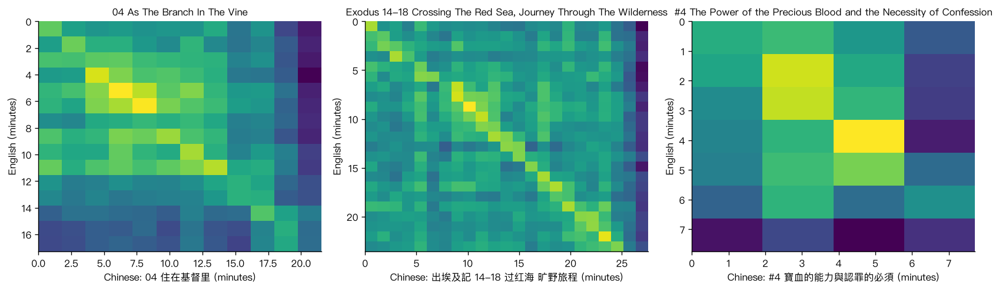
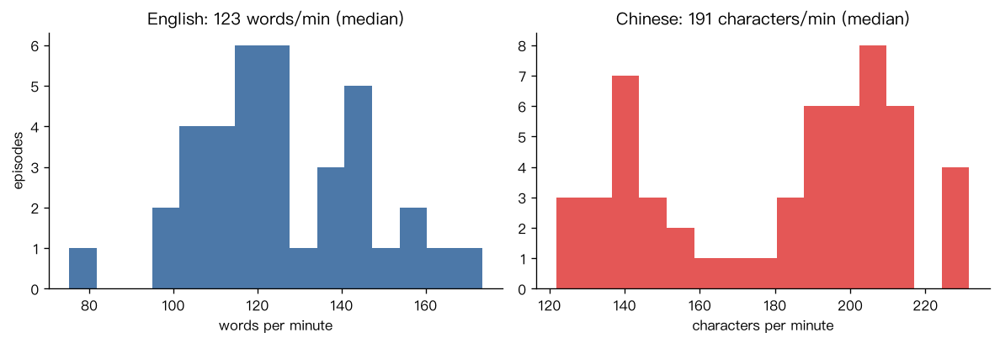

# Matching English and Chinese Sermons

My church's app ([拾穗 SJCA](https://github.com/allenlong2007/ChurchApp)) has 91 podcast episodes, and a lot of them exist twice: once in English and once in Chinese. Nothing in the data says which Chinese episode goes with which English one. I wanted to see if a model could figure that out from the audio alone, without translating anything.

So I transcribed all 29 hours with Whisper, turned every episode into vectors with three multilingual embedding models, and tested how often each one ranks the right Chinese episode first.

**The full write-up, with all the code and charts, is in [notebooks/analysis.ipynb](notebooks/analysis.ipynb).**

## Results

35 English episodes, each searched against all 56 Chinese episodes.

| Model | Top-1 accuracy | Top-3 accuracy | Mean reciprocal rank |
|---|---|---|---|
| MiniLM (multilingual) | 94% | 94% | 0.95 |
| LaBSE | 91% | 100% | 0.95 |
| **BGE-M3** | **97%** | **100%** | **0.99** |
| Random guessing | 2% | 7% | 0.09 |



The one episode BGE-M3 got wrong was matched to a chapter built on the same Bible verse with the same structure, and the right answer came in second.

### English and Chinese don't fully mix

Even "language-neutral" models keep a strong signal for which language a text is in. On the left, PCA splits the episodes by language before anything else. Subtracting each language's average vector (right) removes that, and episodes from the same series end up together no matter the language.



Interestingly, that fix made matching slightly *worse* (BGE-M3 dropped from 97% to 94%). Every candidate is Chinese, so they all share the same offset, and it never affected the ranking in the first place.

### The Chinese versions follow the English ones closely

Comparing every English passage to every Chinese passage in a pair gives a clear diagonal, so the Chinese lessons cover the same points in the same order.



### Other things I found

- **Whisper makes things up during music.** It added "Thank you." to the starts of episodes, a YouTube "like and subscribe" line, a fake song credit, and loops like "No." 38 times in a row. The cleaning step in `src/corpus.py` removed about 1,700 of these segments.
- **Whisper gets church words wrong.** 晨更 (morning watch) came out as 陈庚, and 代祷 (intercession) as 代导. The sounds are right and the characters aren't, because those words are rare outside of church.
- **Two speaking speeds.** Devotional readings run around 135 Chinese characters a minute, and Bible study teaching runs around 200.



## How it works

1. `src/download.py` pulls the app's live content catalog and downloads every episode.
2. `src/transcribe.py` runs Whisper large-v3-turbo locally on Apple Silicon through MLX.
3. `src/corpus.py` cleans the transcripts and splits them into passages of about 120 English words or 250 Chinese characters.
4. `src/matching.py` embeds the passages, averages them into one vector per episode, and ranks candidates by cosine similarity. `pairs.csv` is the answer key I labeled by hand.
5. `src/keywords.py` finds each series' most distinctive words with TF-IDF (jieba for splitting Chinese into words).

## Running it

```bash
python3 -m venv .venv
.venv/bin/pip install -r requirements.txt
.venv/bin/python src/download.py
.venv/bin/python src/transcribe.py     # about an hour on an M-series Mac
.venv/bin/jupyter notebook notebooks/analysis.ipynb
```

Transcription needs an Apple Silicon Mac (for MLX) and `ffmpeg` (`brew install ffmpeg`).

## About the data

The recordings and transcripts belong to San Jose Christian Assembly, so `data/` isn't in this repo. Only the code, the hand-labeled pairs, and the aggregate results are.

## Limitations and next steps

35 test pairs is a small set, and I made the answer key myself from episode titles. I spot-checked transcripts but didn't proofread all 29 hours. Next I want to put a short list of church terms in Whisper's prompt and measure how many errors that fixes, and then use the passage start times to build a "search in either language" feature for the church app.
